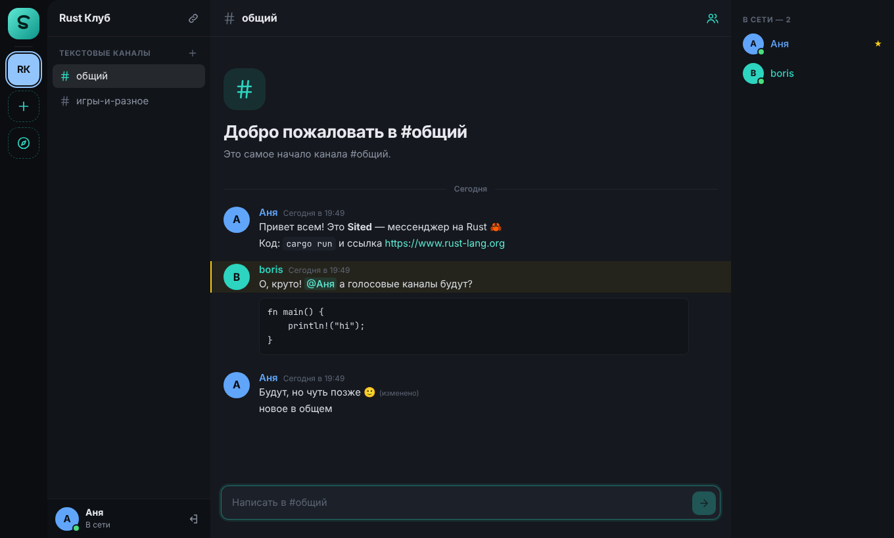

# Sited

Минималистичный мессенджер с серверами, каналами и чатом в реальном времени. Бэкенд написан на **Rust**.



## Возможности

- Регистрация и вход (пароли хешируются Argon2)
- Свои серверы и вход в чужие по коду приглашения
- Текстовые каналы с темой (создаёт владелец сервера)
- Сообщения в реальном времени через WebSocket
- Редактирование (кнопка или ↑ в пустом поле) и удаление сообщений
- Индикатор «печатает…», статусы «в сети / не в сети»
- Непрочитанные каналы и серверы
- Форматирование: `**жирный**`, `*курсив*`, `~~зачёркнутый~~`, `` `код` ``, блоки ```` ``` ````, ссылки, `@упоминания` с подсветкой
- История с подгрузкой при прокрутке вверх
- Адаптивная вёрстка: компьютер, планшет, телефон

## Запуск

```bash
cargo run --release
```

Откройте http://127.0.0.1:3000. Чтобы проверить чат вдвоём, зарегистрируйте второго пользователя в другом браузере или окне инкогнито.

Настройки через переменные окружения:

| Переменная     | По умолчанию     | Что задаёт                  |
|----------------|------------------|-----------------------------|
| `SITED_ADDR`   | `127.0.0.1:3000` | адрес и порт сервера        |
| `SITED_DB`     | `sited.db`       | файл базы SQLite            |
| `SITED_STATIC` | `./static`       | папка с интерфейсом         |

## Устройство

```
src/
  main.rs   — запуск, общее состояние, рассылка событий
  api.rs    — REST API: авторизация, серверы, каналы, сообщения
  ws.rs     — WebSocket: события, «в сети», «печатает…»
  db.rs     — SQLite (rusqlite)
static/     — интерфейс: HTML, CSS, JS без сборщиков
```

Стек: `axum`, `tokio`, `rusqlite`, `argon2`.

## Дальше

- [ ] Личные сообщения и друзья
- [ ] Роли и права
- [ ] Реакции и ответы на сообщения
- [ ] Загрузка файлов и картинок
- [ ] Голосовые каналы (WebRTC)
- [ ] Десктоп-клиент на Tauri
