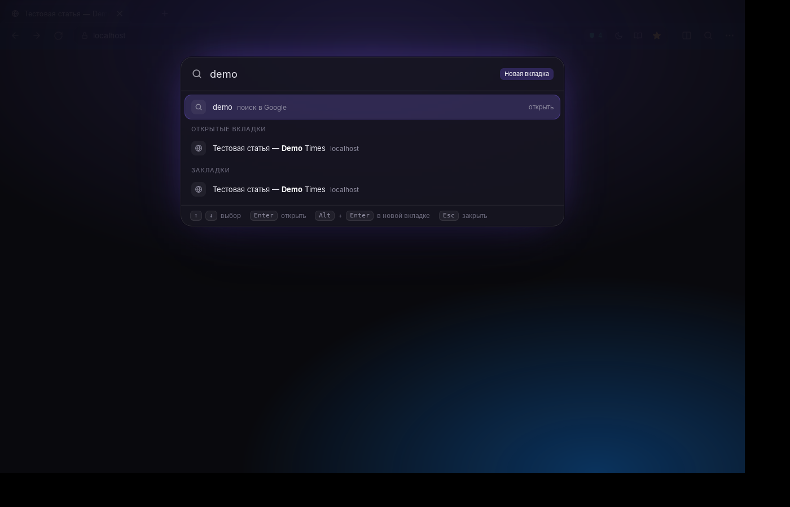
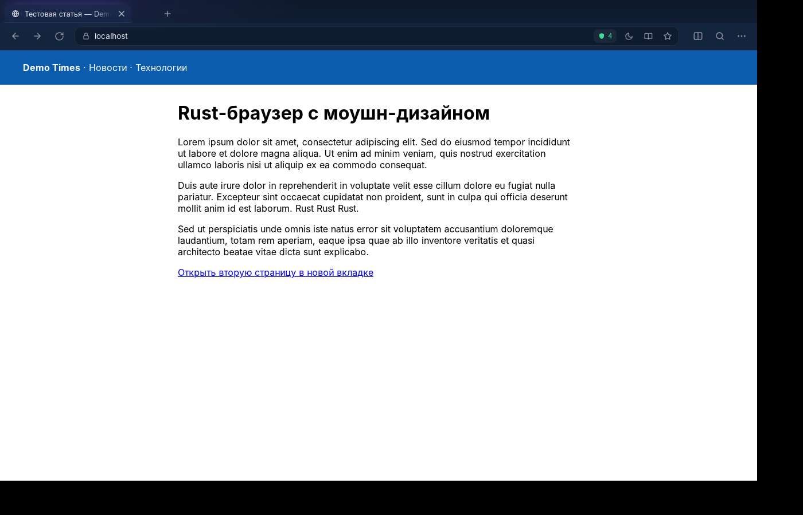
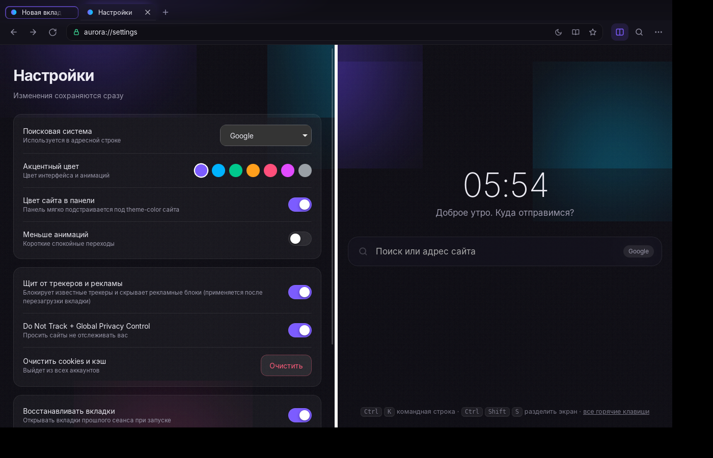

# Aurora — браузер на Rust с моушн-дизайном

Окно — [tao](https://github.com/tauri-apps/tao), движок — [wry](https://github.com/tauri-apps/wry):

| ОС | Движок |
|---|---|
| **Windows 10/11** | **Chromium** (Microsoft Edge WebView2, уже установлен в системе) |
| macOS | WKWebView (Safari) |
| Linux | WebKitGTK |



## Сборка и запуск

```bash
cd browser
cargo run --release
```

* **Windows:** нужен только Rust (MSVC). WebView2 Runtime уже есть в Windows 10/11.
* **Linux:** `sudo apt install libwebkit2gtk-4.1-dev libgtk-3-dev libxdo-dev`
* **Без сборки:** GitHub → Actions → «Build Aurora browser» → Run workflow → скачайте `Aurora-windows-x64` (`aurora.exe`).

Данные (история, закладки, сессия, профиль с cookies) лежат в `%APPDATA%\Aurora` / `~/.local/share/Aurora` / `~/Library/Application Support/Aurora`.

## Что умеет

**Моушн-дизайн**
* Вкладки «вырастают» и схлопываются на пружинных кривых; подложка активной вкладки скользит под курсором (glider с «ушками»).
* Перетаскивание вкладок с FLIP-анимацией соседей.
* Командная строка в стиле Arc/Raycast: размытие, пружинное появление, скользящая подсветка выбранного пункта.
* Панель плавно перекрашивается в `theme-color` сайта (через `@property`, цвет интерполируется).
* Градиентный прогресс загрузки, всплывающие тосты, «взрыв» звёздочки при добавлении в закладки, «пульс» счётчика щита.
* Новая вкладка с живым «северным сиянием», часами и плитками частых сайтов.
* Настройка «Меньше анимаций».

**Функции**
* **Командная строка** (`Ctrl+K` / `Ctrl+L` / `Ctrl+T`): адрес, поиск, нечёткий поиск по открытым вкладкам, закладкам, истории и всем командам (`>` — только команды).
* **Split View** (`Ctrl+Shift+S`): две вкладки рядом.
* **Щит**: блокирует известные трекеры и рекламные скрипты (fetch/XHR/beacon/скрипты/пиксели) и прячет рекламные блоки. Счётчик блокировок в адресной строке.
* **Сон вкладок**: фоновые вкладки выгружаются из памяти через N минут и просыпаются по клику. Восстановленные вкладки грузятся лениво.
* **Режим чтения** (`Alt+R`) и **тёмная тема для любого сайта** (`Alt+D`).
* Инкогнито-вкладки (`Ctrl+Shift+N`) с отдельным оформлением.
* Восстановление сессии (сохраняется и периодически, на случай сбоя), закрепление вкладок, дублирование, «вернуть закрытую».
* Поиск на странице с количеством совпадений, масштаб для каждой вкладки, загрузки с уведомлениями, печать, DevTools, полноэкранный режим.
* Do Not Track + Global Privacy Control.
* Шесть поисковиков: Google, DuckDuckGo, Bing, Brave, Яндекс, Startpage.
* Горячие клавиши работают на любой раскладке (определяются по физической клавише).
* Окно без рамки с собственной анимированной панелью заголовка (Windows).




## Архитектура

```
src/main.rs        окно, вкладки, раскладка, IPC, сон вкладок, сессия, загрузки
src/store.rs       настройки / закладки / история / загрузки / сессия (JSON, атомарная запись)
src/urls.rs        логика омнибокса, поисковики, внутренние aurora:// адреса (+ unit-тесты)
src/pages.rs       протокол aurora:// (новая вкладка, история, закладки, загрузки, настройки)
src/ui/chrome.html интерфейс браузера (вкладки, тулбар, командная строка, меню, анимации)
src/ui/pages.html  внутренние страницы
src/ui/content.js  скрипт, внедряемый в сайты: горячие клавиши, щит, мета, поиск, чтение, тёмная тема
```

* Rust хранит всё состояние и отправляет снимки в UI (`Aurora.update(...)`); UI отправляет команды через `window.ipc`.
* Каждая вкладка — отдельный дочерний webview. Скрытые вкладки скрыты, а спящие уничтожены.
* **Безопасность:** сообщения от сайтов проходят через белый список (клавиши, мета, счётчик щита). Привилегированные команды (настройки, очистка данных, открытие файлов) принимаются только со страниц `aurora://`. Эти страницы запрещено встраивать во фреймы (`X-Frame-Options: DENY` + `frame-ancestors 'none'`), так что сайт не может обманом заставить нажать на них (clickjacking).

## Ограничения (честно)

* Только на Windows движок — Chromium. Чтобы получить Chromium на всех ОС, следующий шаг — перейти на CEF (крейт `cef` от tauri-apps). Это даст ~200 МБ дистрибутива и отдельный helper-процесс.
* Щит работает на уровне JS. Он ловит трекеры, которые подключаются скриптами, но не все сетевые запросы. Полная сетевая блокировка на Windows делается через `ICoreWebView2::AddWebResourceRequestedFilter`.
* Пока открыта командная строка или меню, страница скрывается под фоном: дочерние webview всегда рисуются поверх интерфейса.
* Linux/X11: после `Ctrl+F` поле поиска иногда не получает фокус без клика. Это ограничение фокуса между дочерними окнами WebKitGTK.
